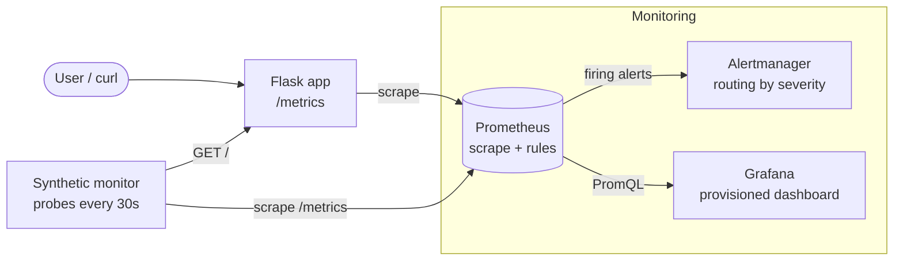

# Observability Lab

A production-style observability and reliability stack for a Python service. It covers
metrics, SLOs with error budgets, burn-rate alerting, synthetic monitoring and dashboards-as-code,
and runs both on **Docker Compose** and **Kubernetes**.

The point of the project is the SRE practice around the service, not the service itself: how you
know it is healthy, how you get paged before users notice, and how you learn from incidents.

## Architecture



| Component | Role |
|---|---|
| **App** (`app/`) | Flask service instrumented with `prometheus_client`: request counter by endpoint/status, latency histogram, `/error` endpoint to simulate failures, `/healthz` for probes |
| **Synthetic monitor** (`synthetic-monitor/`) | Black-box probe that calls the app like a user and exports success, status code and response time |
| **Prometheus** | Scrapes both services, evaluates recording rules (SLIs) and alert rules |
| **Alertmanager** | Groups alerts and routes them by `severity` (critical / warning) |
| **Grafana** | Datasource and dashboard provisioned from this repo, nothing configured by hand |

## What it demonstrates

- **Golden signals**: traffic, errors and latency (P95 and average) for every request
- **SLOs and error budgets**: 99.5% of requests succeed over 30 days, measured from real requests
  (request-based SLI), with the remaining error budget tracked on the dashboard
- **Multi-window, multi-burn-rate alerting** ([Google SRE Workbook](https://sre.google/workbook/alerting-on-slos/)):
  page on fast budget burn, open a ticket on slow burn, with few false positives
- **Tested alerts**: alert rules have unit tests run with `promtool test rules`
- **Synthetic monitoring**: catches failures even when no real users are sending traffic
- **Dashboards-as-code**: Grafana state is disposable; a fresh instance always comes back with the same dashboard
- **Kubernetes**: Kustomize, per-pod service discovery with least-privilege RBAC, probes,
  resource limits, restricted Pod Security Standard, non-root read-only containers, config-change rollouts
- **Incident response**: simulated outage with a written [postmortem](docs/incident-postmortem-001.md)

## Quick start (Docker Compose)

Requirements: Docker with Compose v2.

```bash
docker compose up -d --build
```

| Service | URL |
|---|---|
| Grafana (admin / admin) | http://localhost:3000, dashboard *SRE Dashboards → Application Reliability* |
| Prometheus | http://localhost:9090 |
| Alertmanager | http://localhost:9093 |
| App | http://localhost:5000 |

Stop with `docker compose down` (add `-v` to also drop Grafana's volume; the dashboard is re-provisioned anyway).

## Run on Kubernetes

Requirements: [kind](https://kind.sigs.k8s.io/), kubectl and Docker. Stop the Compose stack first, because both use the same localhost ports.

```bash
# 1. Local cluster with NodePorts mapped to localhost:3000/9090/9093/5000
kind create cluster --config k8s/kind-config.yaml

# 2. Build the two app images and load them into the cluster
docker compose build
kind load docker-image observability-lab/app:1.0.0 observability-lab/synthetic-monitor:1.0.0 --name observability-lab

# 3. Deploy everything
kubectl apply -k .
kubectl -n observability-lab rollout status deploy --timeout=300s
```

The same URLs as above work. Clean up with `kind delete cluster --name observability-lab`.

How the Kubernetes setup is built:

- **One source of truth.** `kustomization.yaml` generates ConfigMaps from the same files Compose mounts
  (alert rules, Alertmanager config, Grafana provisioning and dashboard). Kustomize hashes their contents,
  so changing a file and re-running `kubectl apply -k .` rolls the affected pods automatically.
- **Pod discovery instead of Service scraping.** The app runs 2 replicas. Scraping the Service would hit a
  random pod on each scrape and make counters jump, so Prometheus uses `kubernetes_sd_configs`
  ([k8s/prometheus/prometheus.yml](k8s/prometheus/prometheus.yml)) to scrape each pod. It may only
  list pods in its own namespace (namespaced `Role`).
- **Hardened workloads.** The namespace enforces the `restricted` Pod Security Standard: non-root users,
  all capabilities dropped, `RuntimeDefault` seccomp and read-only root filesystems where possible.
  Every container has liveness/readiness probes and resource requests/limits.

## SLO and alerting

**Objective:** 99.5% of HTTP requests return a non-5xx response over a rolling 30 days.
That gives an error budget of 0.5% of requests, roughly 3.6 hours of full outage per month.

Recording rules pre-compute the error ratio `slo:app_request_errors:ratio_rate<window>` for windows from
5m to 30d ([alerts/alert-rules.yml](alerts/alert-rules.yml)). Alerts use two windows each: the long window
shows the problem is significant, the short window lets the alert resolve quickly once it is fixed.

| Alert | Severity | Burn rate | Windows | Meaning |
|---|---|---|---|---|
| `SLOErrorBudgetBurnFast` | critical (page) | 14.4x | 1h and 5m | 2% of the monthly budget gone in 1 hour |
| `SLOErrorBudgetBurnFast` | critical (page) | 6x | 6h and 30m | 5% of the budget gone in 6 hours |
| `SLOErrorBudgetBurnSlow` | warning (ticket) | 3x | 1d and 2h | 10% of the budget gone in 1 day |
| `SLOErrorBudgetBurnSlow` | warning (ticket) | 1x | 3d and 6h | Budget on track to run out this month |
| `HighErrorRate` | critical | n/a | 2m | More than 5% of requests failing right now |
| `ApplicationDown` | critical | n/a | 1m | Prometheus cannot scrape an app target |
| `HighRequestVolume` | warning | n/a | 1m | Traffic above the expected baseline |

Validate and test the rules:

```bash
docker run --rm --entrypoint sh -v "$PWD/alerts:/alerts" -w /alerts prom/prometheus:v3.16.0 \
  -c "promtool check rules alert-rules.yml && promtool test rules tests/alert-rules.test.yml"
```

## Simulate an incident

```bash
# Error burst: burns the error budget, fires HighErrorRate and the burn-rate alerts after their `for:` period
for i in $(seq 1 100); do curl -s -o /dev/null localhost:5000/error; done

# Outage: fires ApplicationDown; the synthetic monitor reports FAILED
docker stop observability-app                                   # Compose
kubectl -n observability-lab scale deploy/app --replicas=0      # Kubernetes
```

Watch it on the Grafana dashboard and under *Alerts* in Prometheus (http://localhost:9090/alerts), then restore
with `docker start observability-app` or `--replicas=2`. A worked example is in
[docs/incident-postmortem-001.md](docs/incident-postmortem-001.md).

> Note: on a freshly started lab the 30-day window only contains a few minutes of data, so a short error burst
> shows a large negative error budget. In a long-running system the same burst would barely move it.

## Repository layout

```
app/                     Instrumented Flask service + Dockerfile
synthetic-monitor/       Black-box availability / latency probe
prometheus/              Prometheus config for Docker Compose (static targets)
alerts/                  Recording rules, alert rules and their unit tests
alertmanager/            Alert routing by severity
grafana/                 Datasource + dashboard provisioning, dashboard JSON
k8s/                     Kubernetes manifests, Prometheus config with pod discovery, kind cluster config
kustomization.yaml       Kustomize entry point (kubectl apply -k .)
docs/                    Incident postmortem
docker-compose.yml       Local stack
```

## Possible next steps

- Send Alertmanager notifications to a real channel (Slack, PagerDuty or email)
- CI pipeline: `promtool` rule tests, `amtool check-config` and manifest validation on every push
- Persistent storage for Prometheus, and Grafana behind an Ingress with real credentials
- Tracing and logs (OpenTelemetry, Tempo, Loki) correlated with the metrics

## Author

**Juan Pablo Molina**, Site Reliability Engineer
